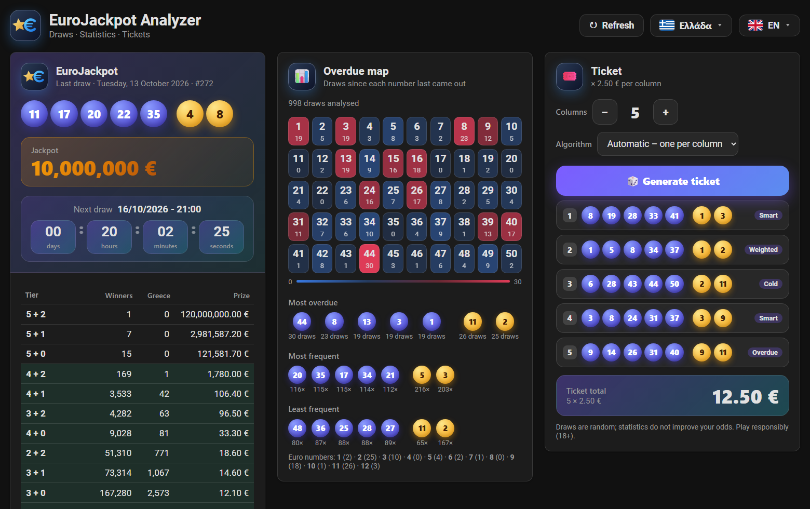
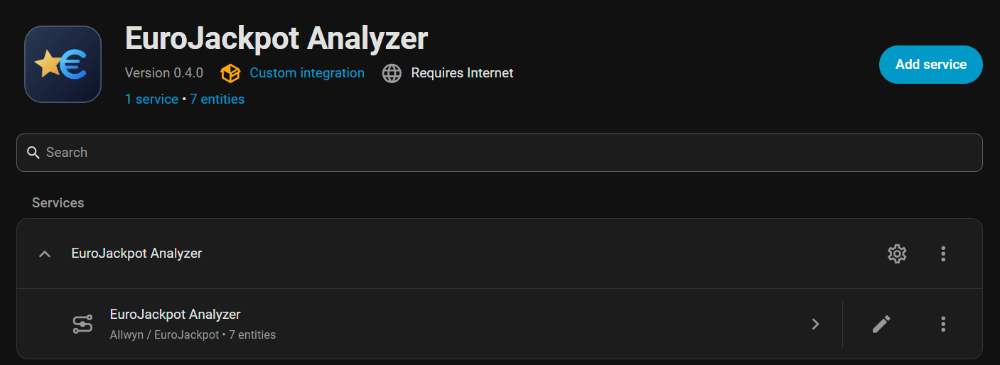
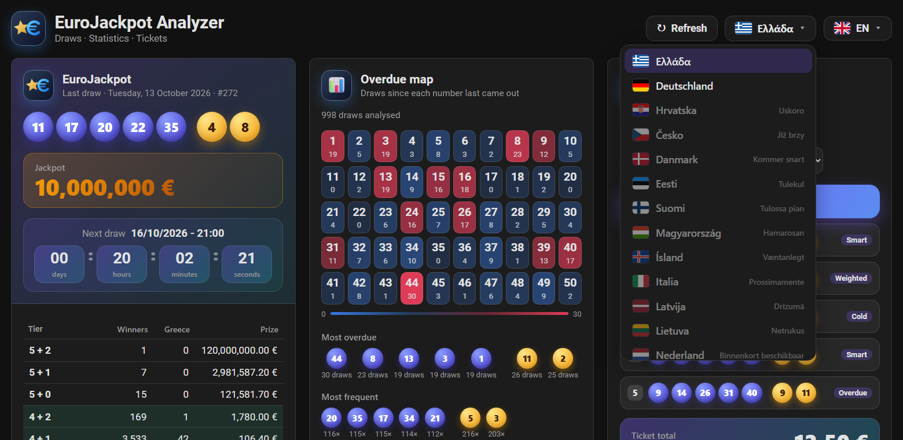
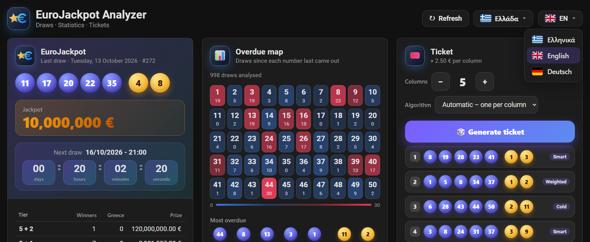
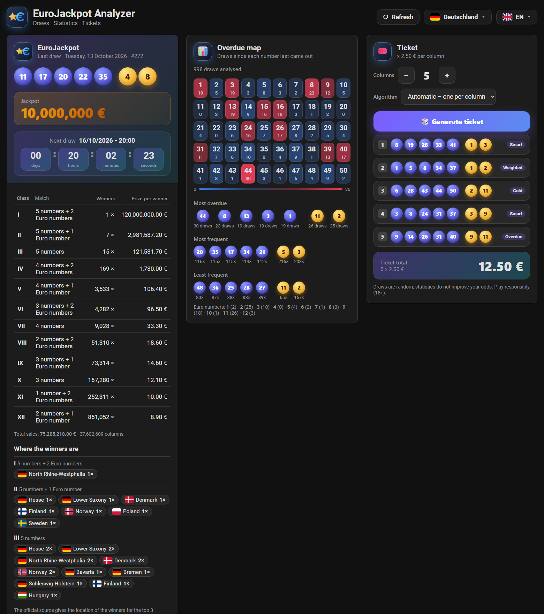
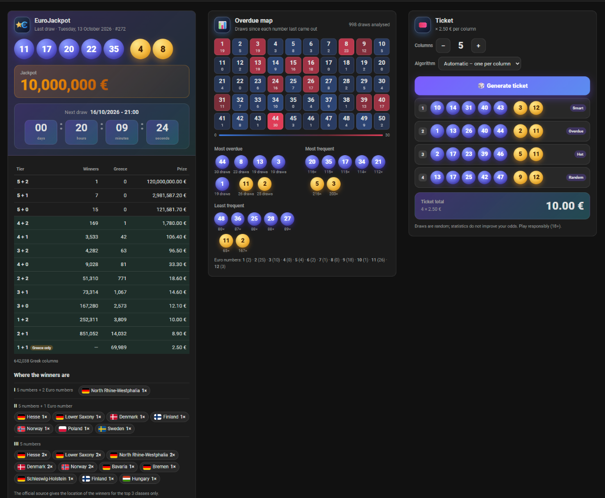
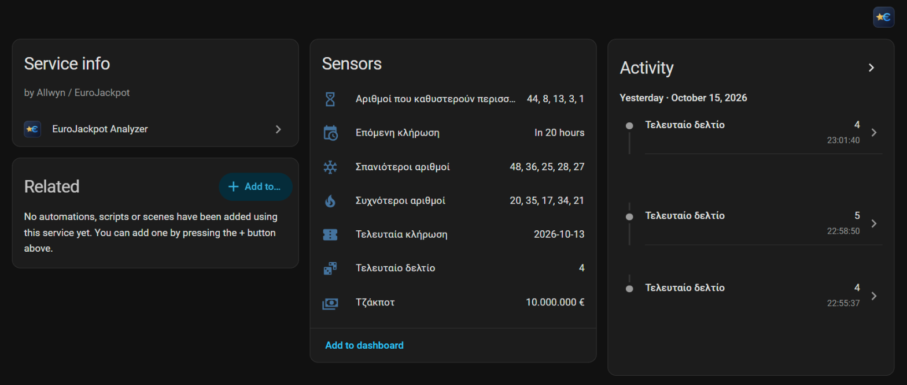
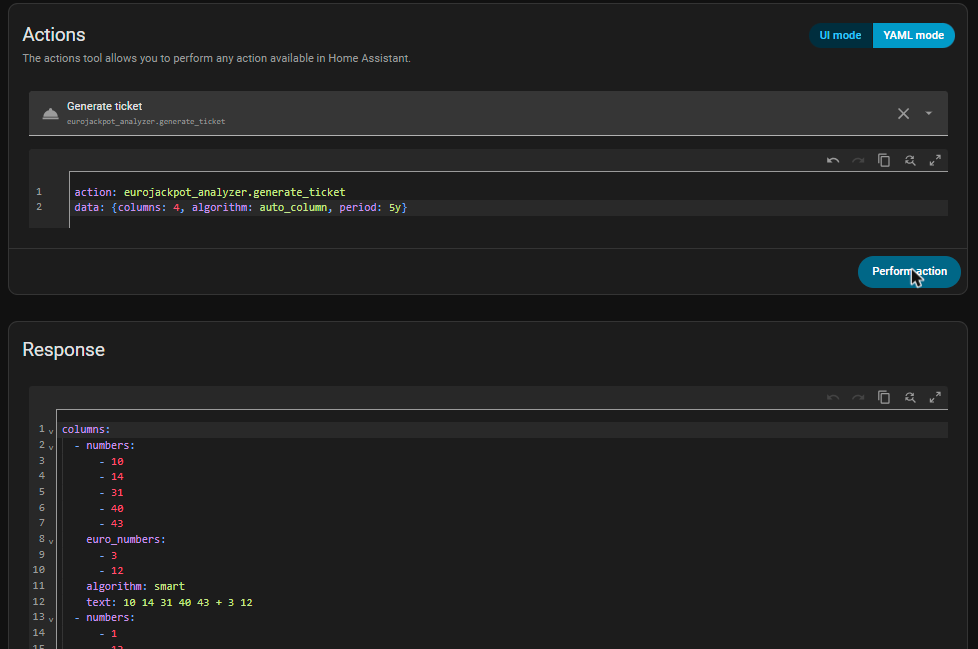

# EuroJackpot Analyzer for Home Assistant

🇬🇷 **[Ελληνικές οδηγίες → README.md](README.md)**

EuroJackpot in Home Assistant, with its own **sidebar panel** that fills the whole screen:

- **Last draw**: numbers, winners and prizes per class and the **big jackpot**, **the way they are presented in your country** (Greece or Germany), and where the prizes were won.
- **Next draw** with date/time and a countdown `DD : HH : MM : SS`.
- **Overdue map** of the 50 numbers with colours, and rankings: most overdue, most frequent, least frequent.
- **Ticket generator** of 1–12 columns with 7 algorithms or automatic choice, with the total cost (price per column is editable, default €2.50).
- **Greek / English / German** and a **country selector**, both in flag menus. A change applies instantly.

No account and no API key needed. The data comes from Allwyn and the official EuroJackpot service.
The history since 2012 is already bundled, so it works immediately and even without internet.

It is the sister integration of the Windows app
[EuroJackpot Analyzer](https://github.com/VeZReVouLiS/EuroJackpot-Analyzer): same algorithms, same statistics, same look.



## Installation (HACS)
1. HACS → ⋮ → **Custom repositories** → add `https://github.com/VeZReVouLiS/EuroJackpot-Analyzer-HA` as type **Integration**.
2. Download **EuroJackpot Analyzer** and restart Home Assistant.
3. **Settings → Devices & services → Add integration → EuroJackpot Analyzer**. One click, no settings.
4. The **EuroJackpot Analyzer** entry appears in the sidebar. It opens the panel.

Manual: copy the folder `custom_components/eurojackpot_analyzer` to `config/custom_components/`.

> **After every update** restart Home Assistant and refresh the page with **Ctrl+F5**,
> so the browser picks up the new panel program.



## The panel
The panel adapts to the window size: on a big PC screen the letters, numbers and fields grow and the three columns
(draw, statistics, ticket) fill the whole width. In a smaller window or on a phone they fall back to two or one column.

- **Country and language**: two menus at the top right, each entry with a flag and written in its own language (ΕΛ / EN / DE). A change applies instantly, without a refresh, to the whole panel and to every card, and the choice is remembered in your browser.
  If you have not chosen, the language of the Home Assistant user and the country of your Home Assistant installation are used (when that is Greece or Germany, otherwise Greece).
- **Available countries**: Greece and Germany. The others show “coming soon” in their own language and will be added later.
- **Refresh**: asks for new data immediately.
- The **overdue map** shows for every number how many draws have passed since it last came out (red = more overdue). Hover a number to see how often it has been drawn in total.





### The country decides how the draw looks
- **Greece** (like Allwyn): winners of all countries, winners in Greece and prize per class, including the **1 + 1** class that exists only in Greece.
- **Germany** (like the official eurojackpot.com): *Class* (I–XII), *Match* (e.g. “5 numbers + 2 Euro numbers”), *Winners*, *Prize per winner* and the total sales. Below it, **“Where the winners are”** shows in which country and, for Germany, in which federal state the winners were found. The official source gives this information **for the top 3 classes only**.



## Cards for your own dashboards
The same screens are available as Lovelace cards. They are loaded automatically by the integration, with no resource setup:

| Card | What it shows |
|---|---|
| `custom:eurojackpot-analyzer-last-draw-card` | last draw, jackpot, next draw with countdown, prize table (`show_prizes: false` to hide) |
| `custom:eurojackpot-analyzer-stats-card` | overdue map and rankings |
| `custom:eurojackpot-analyzer-ticket-card` | ticket generator (`columns`, `algorithm` set the initial values) |

All accept `language: el`, `en` or `de` and `country: GR` or `DE` if you want a fixed language and layout. A ready-made dashboard example: [docs/dashboard.yaml](docs/dashboard.yaml).



## Entities
| Entity | Value | Attributes |
|---|---|---|
| `sensor.eurojackpot_analyzer_last_draw` | date of the last draw | `numbers`, `euro_numbers`, `text`, `draw_number`, `prizes` (winners of all countries / Greece, prize per class and, for the top 3 classes, `where_won` per country/state), `total_sales`, `columns_greece`, `columns_all_countries` |
| `sensor.eurojackpot_analyzer_next_draw` | date and time of the next draw | `draw_number` |
| `sensor.eurojackpot_analyzer_jackpot` | jackpot in € | `next_draw` |
| `sensor.eurojackpot_analyzer_most_overdue_numbers` | the 5 most overdue numbers | `main` and `euro` with `draws_since`, `longest_gap`, `last_seen`, the full table `all` |
| `sensor.eurojackpot_analyzer_most_frequent_numbers` | the 5 most frequent numbers | `main` and `euro` with `count`, `percent` |
| `sensor.eurojackpot_analyzer_least_frequent_numbers` | the 5 least frequent numbers | as above |
| `sensor.eurojackpot_analyzer_generated_ticket` | columns of the last ticket | `columns`, `total_cost`, `algorithm`, `generated_at` |

Names are shown in Greek, English or German depending on the language of HA (entity IDs are always the English ones from the list).



(The entity names follow the system language of Home Assistant, which is Greek on this installation.)

## Service `eurojackpot_analyzer.generate_ticket`
| Field | Values | Default |
|---|---|---|
| `columns` | 1–12 | 5 |
| `algorithm` | `auto_ticket`, `auto_column`, `random`, `hot`, `cold`, `overdue`, `weighted`, `balanced`, `smart` | `auto_ticket` |
| `period` | `all`, `10y`, `5y`, `3y`, `1y`, `last_100`, `last_50` | `all` |

The response contains `columns` (each with `numbers`, `euro_numbers`, `algorithm`, `text`), `total_cost` and `price_per_column`.
The result is also stored in `sensor.eurojackpot_analyzer_generated_ticket` and the event `eurojackpot_analyzer_ticket_generated` is fired.

Try it in **Developer tools → Actions**:

```yaml
action: eurojackpot_analyzer.generate_ticket
data:
  columns: 6
  algorithm: auto_column
  period: 5y
response_variable: ticket
```



> Draws are random. Statistics do not improve your odds. Play responsibly (18+).

## Automation examples
**Notification when a new draw is out**

```yaml
alias: EuroJackpot - new draw
triggers:
  - trigger: state
    entity_id: sensor.eurojackpot_analyzer_last_draw
actions:
  - action: notify.notify
    data:
      title: EuroJackpot
      message: >
        Draw {{ states('sensor.eurojackpot_analyzer_last_draw') }}:
        {{ state_attr('sensor.eurojackpot_analyzer_last_draw', 'text') }}
```

**A ticket every Tuesday and Friday morning**

```yaml
alias: EuroJackpot - ticket suggestion
triggers:
  - trigger: time
    at: "09:00:00"
conditions:
  - condition: time
    weekday: [tue, fri]
actions:
  - action: eurojackpot_analyzer.generate_ticket
    data: { columns: 5, algorithm: auto_column }
    response_variable: t
  - action: notify.notify
    data:
      title: "Ticket {{ t.total_cost }} €"
      message: "{{ c.text }}\n"
```

## Options
**Settings → EuroJackpot Analyzer → Configure**: refresh interval (10–720 minutes, default 30) and price per column (default €2.50 for Greece; for Germany enter €2.00 per field plus the handling fee of the provider you play with).
The sensors also refresh at 21:20, 21:50, 22:20, 22:50, 23:20 and 23:50, after the draw.

## For developers
The shared core (`core/rules.py`, `core/stats.py`, `core/generators.py`) and the history (`data/draws.json`) are copied
automatically from [EuroJackpot-Analyzer](https://github.com/VeZReVouLiS/EuroJackpot-Analyzer) (`tools/sync_ha.ps1`). Do not
edit them here.

The front-end is a single file with no framework and no build (`www/eurojackpot-analyzer-card.js`). The flags, the logo and the country catalogue (`www/assets/`) are copied from the app too. To see it without Home Assistant:
`python tools/make_preview_fixture.py`, `python -m http.server 8770` and open `http://127.0.0.1:8770/tools/preview/index.html` (hash parameters: `#view=panel&lang=de&country=DE&theme=light&menu=country`).
Flags are from [flag-icons](https://github.com/lipis/flag-icons) (MIT).

```bash
python -m venv .venv && .venv/bin/pip install pytest-homeassistant-custom-component
.venv/bin/python -m pytest -q
```
Home Assistant core does not run on Windows; the tests run on GitHub Actions (tests, hassfest and HACS validation).
