# EuroJackpot Analyzer για Home Assistant

🇬🇧 **[English instructions → README.en.md](README.en.md)**

Το EuroJackpot στο Home Assistant, με δικό του **panel στο πλαϊνό μενού** που γεμίζει όλη την οθόνη:

- **Τελευταία κλήρωση**: αριθμοί, επιτυχίες και κέρδη ανά κατηγορία και **μεγάλο τζάκποτ**, **όπως παρουσιάζονται στη χώρα σου** (Ελλάδα ή Γερμανία) και πού κερδήθηκε.
- **Επόμενη κλήρωση** με ημερομηνία/ώρα και αντίστροφη μέτρηση `ΗΗ : ΩΩ : ΛΛ : ΔΔ`.
- **Χάρτης καθυστέρησης** των 50 αριθμών με χρώματα, και κατατάξεις: αριθμοί που καθυστερούν, συχνότεροι, σπανιότεροι.
- **Γεννήτρια δελτίων** 1-12 στηλών με 7 αλγορίθμους ή αυτόματη επιλογή, με σύνολο κόστους (τιμή ανά στήλη ρυθμιζόμενη, προεπιλογή 2,50 €).
- **20 γλώσσες** (Ελληνικά, English, Deutsch και οι γλώσσες όλων των χωρών του EuroJackpot, μεταφρασμένες με τεχνητή νοημοσύνη) και **επιλογή χώρας** από μενού με σημαίες. Η αλλαγή ισχύει αμέσως.

Δεν χρειάζεται λογαριασμός ούτε API key. Τα δεδομένα έρχονται από την Allwyn και την επίσημη υπηρεσία του EuroJackpot.
Το ιστορικό από το 2012 είναι ήδη ενσωματωμένο, οπότε δουλεύει αμέσως και χωρίς internet.

Είναι η αδελφή ενσωμάτωση της εφαρμογής Windows
[EuroJackpot Analyzer](https://github.com/VeZReVouLiS/EuroJackpot-Analyzer): ίδιοι αλγόριθμοι, ίδια στατιστικά, ίδια εμφάνιση.

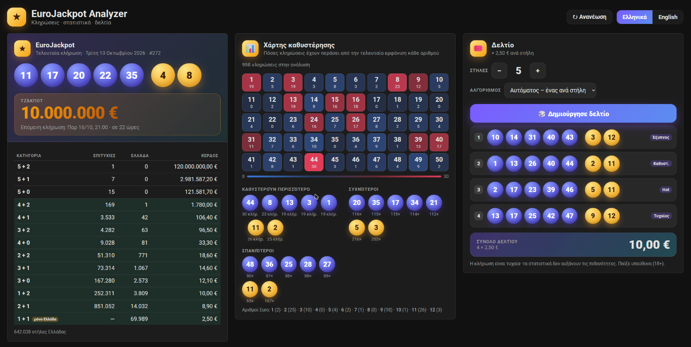

## Εγκατάσταση (HACS)
1. HACS → ⋮ → **Custom repositories** → πρόσθεσε `https://github.com/VeZReVouLiS/EuroJackpot-Analyzer-HA` με τύπο **Integration**.
2. Κατέβασε το **EuroJackpot Analyzer** και κάνε επανεκκίνηση του Home Assistant.
3. **Ρυθμίσεις → Συσκευές και υπηρεσίες → Προσθήκη ενσωμάτωσης → EuroJackpot Analyzer**. Ένα κλικ, χωρίς ρυθμίσεις.
4. Στο πλαϊνό μενού εμφανίζεται η καταχώρηση **EuroJackpot Analyzer**. Ανοίγει το panel.

Χειροκίνητα: αντίγραψε τον φάκελο `custom_components/eurojackpot_analyzer` στο `config/custom_components/`.

> **Μετά από κάθε ενημέρωση** κάνε επανεκκίνηση του Home Assistant και ανανέωσε τη σελίδα με **Ctrl+F5**,
> ώστε ο browser να πάρει το νέο πρόγραμμα του panel.

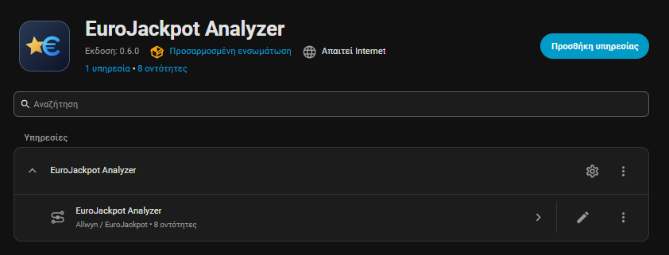

## Το panel
Το panel προσαρμόζεται στο μέγεθος του παραθύρου: σε μεγάλη οθόνη PC τα γράμματα, οι αριθμοί και τα πεδία μεγαλώνουν και οι τρεις στήλες
(κλήρωση, στατιστικά, δελτίο) γεμίζουν όλο το πλάτος. Σε μικρότερο παράθυρο ή κινητό περνούν σε δύο ή μία στήλη.

- **Χώρα και γλώσσα**: δύο μενού πάνω δεξιά, με σημαία και το όνομα κάθε χώρας/γλώσσας στη δική της γλώσσα (ΕΛ / EN / DE). Η αλλαγή ισχύει αμέσως, χωρίς refresh, σε όλο το panel και σε όλες τις κάρτες, και θυμάται την επιλογή σου στον browser.
  Αν δεν έχεις διαλέξει, χρησιμοποιείται η γλώσσα του χρήστη και η χώρα της εγκατάστασης του Home Assistant (αν είναι Ελλάδα ή Γερμανία, αλλιώς Ελλάδα).
- **Διαθέσιμες χώρες**: Ελλάδα και Γερμανία. Οι υπόλοιπες δείχνουν «σύντομα» στη γλώσσα τους και θα προστεθούν αργότερα.
- **Ανανέωση**: ζητά αμέσως νέα δεδομένα.
- Ο **χάρτης καθυστέρησης** δείχνει για κάθε αριθμό πόσες κληρώσεις έχουν περάσει από την τελευταία φορά που βγήκε (κόκκινο = καθυστερεί περισσότερο). Με το ποντίκι πάνω σε έναν αριθμό βλέπεις πόσες φορές έχει βγει συνολικά.

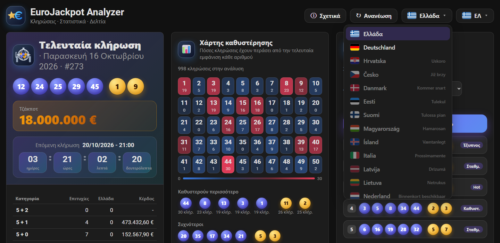

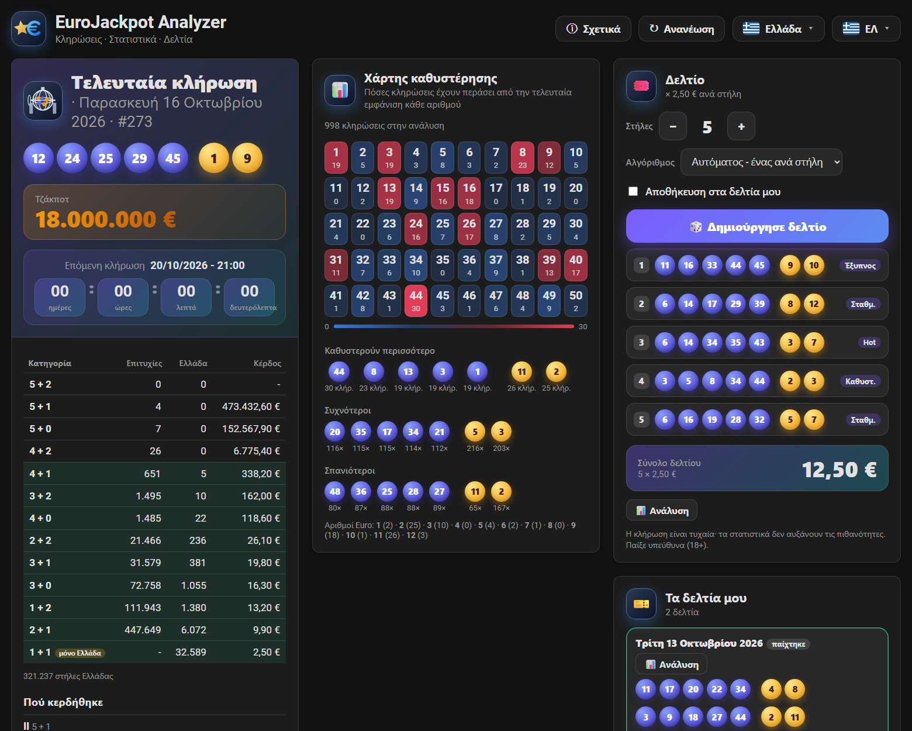

### Η χώρα ορίζει πώς φαίνεται η κλήρωση
- **Ελλάδα** (όπως στην Allwyn): επιτυχίες όλων των χωρών, επιτυχίες στην Ελλάδα και κέρδος ανά κατηγορία, με την κατηγορία **1 + 1** που ισχύει μόνο στην Ελλάδα.
- **Γερμανία** (όπως στο επίσημο eurojackpot.com): *Κατηγορία* (I-XII), *Επιτυχίες* (π.χ. «5 + 2»), *Νικητές*, *Κέρδος ανά νικητή* και συνολικός τζίρος. Από κάτω η ενότητα **«Πού κερδήθηκε»** δείχνει σε ποια χώρα και, για τη Γερμανία, σε ποιο κρατίδιο βρέθηκαν οι νικητές. Η επίσημη πηγή δίνει αυτή την πληροφορία **μόνο για τις 3 πρώτες κατηγορίες**.

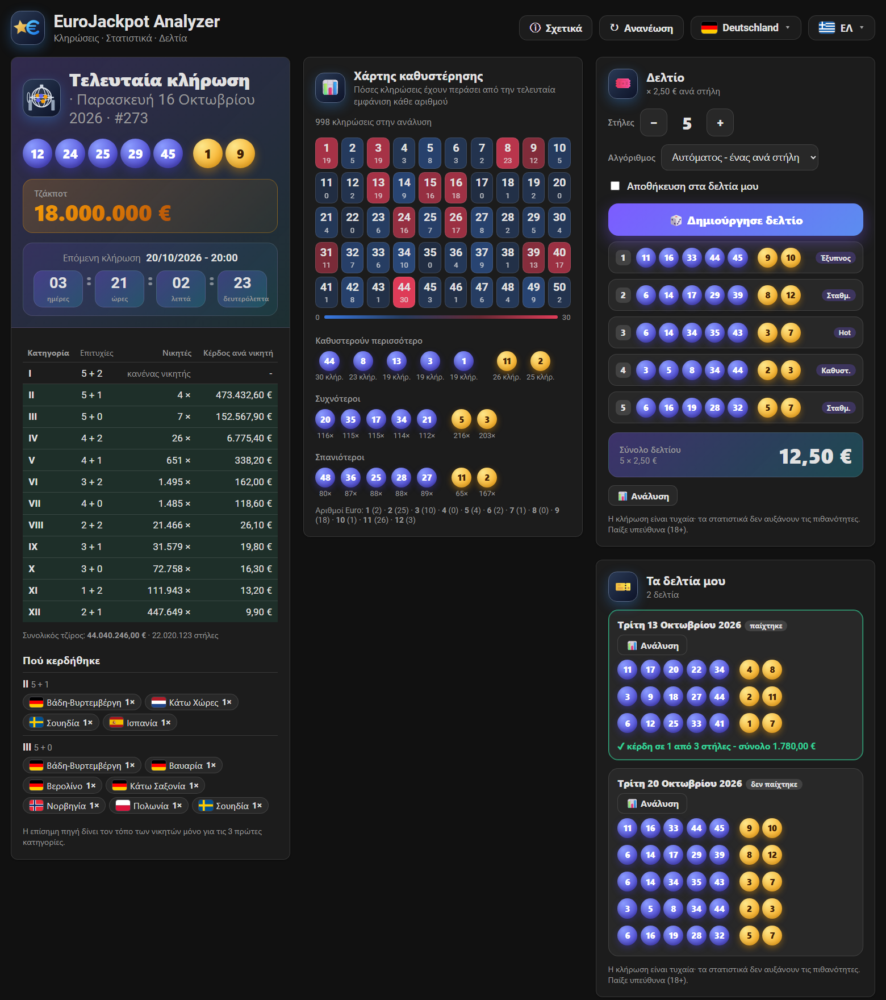

## Τα δελτία μου, ανάλυση και συγχρονισμός
Η κάρτα **Τα δελτία μου** (κάτω δεξιά στο panel) δείχνει τα δελτία σου, αν έπαιξαν, και το **αποτέλεσμα** μόλις βγει η κλήρωση τους. Το κουμπί **Ανάλυση** ανοίγει πιθανότητες, αναμενόμενο κόστος/κέρδος, στατιστικό προφίλ κάθε στήλης και έλεγχο στο ιστορικό (τι θα είχε κερδίσει από το 2012):

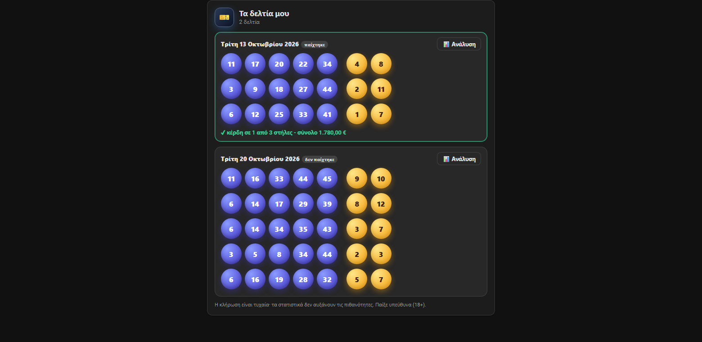

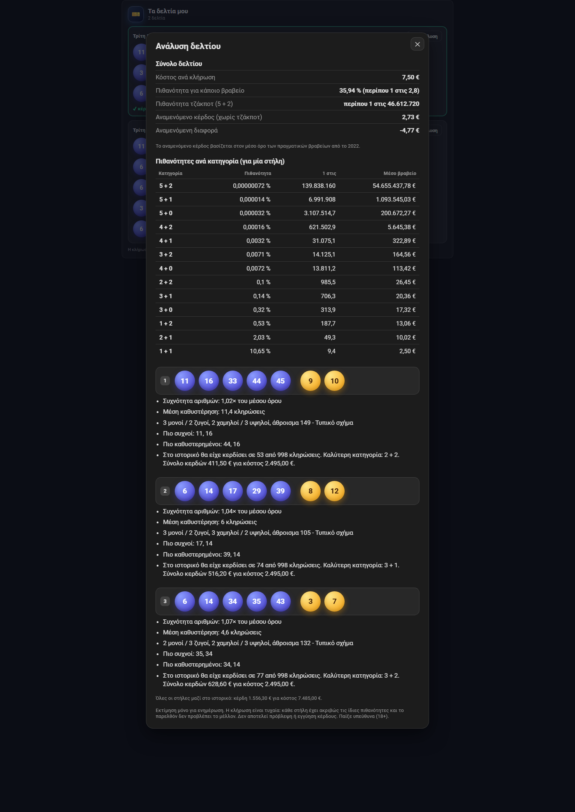

Είναι στατιστική ενημέρωση, **όχι πρόβλεψη**: η κλήρωση είναι τυχαία και κάθε στήλη έχει τις ίδιες πιθανότητες.

**Δελτία από τις εφαρμογές (Windows, Mac, Android, iPhone):** στην εφαρμογή πήγαινε στις Ρυθμίσεις → Συγχρονισμός δελτίων και φτιάξε ένα token GitHub (δικαίωμα `gist`, ο οδηγός ανοίγει την κατάλληλη σελίδα). Μετά βάλε το **ίδιο token** στο Home Assistant: **Ρυθμίσεις → Συσκευές και υπηρεσίες → EuroJackpot Analyzer → Ρύθμιση → Token GitHub**. Τα δελτία συγχρονίζονται μέσω ιδιωτικού gist του δικού σου λογαριασμού. Δελτία που φτιάχνεις στο Home Assistant με «Αποθήκευση στα δελτία μου» (ή `save: true`) εμφανίζονται και στις εφαρμογές. Χωρίς token η κάρτα δείχνει μόνο όσα αποθήκευσες εδώ. Ο συγχρονισμός μέσω **Google Drive** των εφαρμογών δεν υποστηρίζεται ακόμα στο Home Assistant: για να φτάνουν τα δελτία εδώ, διάλεξε GitHub στην εφαρμογή.

## Ειδοποιήσεις
Στις **Επιλογές** (Ρύθμιση) μπορείς να ορίσεις:
- **Υπηρεσία ειδοποιήσεων**, π.χ. `notify.mobile_app_to_kinito_mou`. Αν μείνει κενή, δεν στέλνονται ειδοποιήσεις (τα γεγονότα παρακάτω στέλνονται πάντα).
- **Ειδοποίηση τζάκποτ από (εκατ. €)**: μία ειδοποίηση ανά κλήρωση όταν το τζάκποτ φτάσει το όριο. `0` = ανενεργή.
- **Token GitHub** για τον συγχρονισμό δελτίων (προαιρετικό).

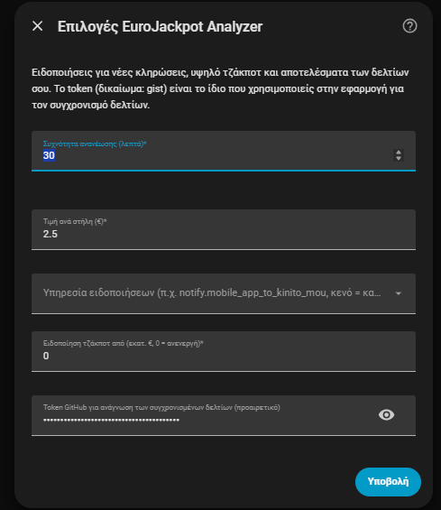

Ειδοποιήσεις: νέα κλήρωση με τους αριθμούς, υψηλό τζάκποτ και το **αποτέλεσμα των δελτίων που έπαιξες** (μόνο όταν η κλήρωση είναι των τελευταίων 7 ημερών). Για δικούς σου αυτοματισμούς υπάρχουν τα γεγονότα:

| Γεγονός | Περιεχόμενο |
|---|---|
| `eurojackpot_analyzer_new_draw` | `date`, `numbers`, `euro_numbers`, `text`, `draw_number`, `jackpot_next` |
| `eurojackpot_analyzer_jackpot_alert` | `jackpot`, `draw_time`, `threshold` |
| `eurojackpot_analyzer_ticket_result` | `uid`, `date`, `winning_columns`, `total_prize`, `complete`, `tiers` |

## Σχετικά
Το κουμπί **ⓘ Σχετικά** πάνω δεξιά στο panel ανοίγει οδηγίες χρήσης, πηγές δεδομένων, credits και συνδέσμους (στη γλώσσα που διάλεξες):

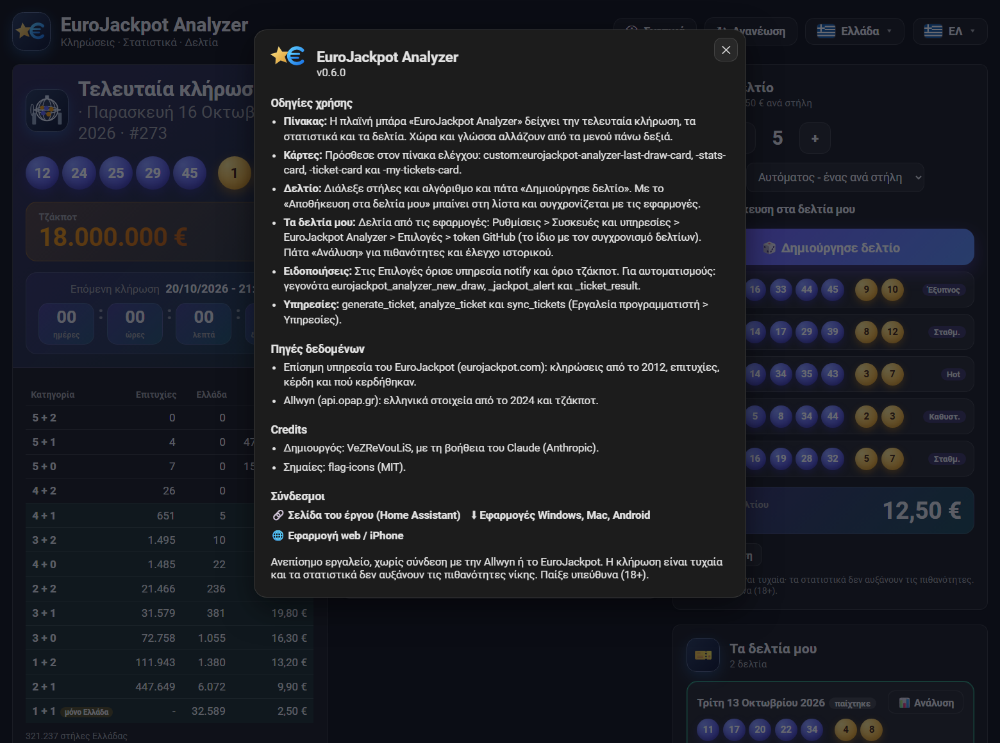

## Κάρτες για τα δικά σου dashboards
Οι ίδιες οθόνες είναι διαθέσιμες και ως κάρτες Lovelace. Φορτώνονται αυτόματα από το integration, χωρίς καμία ρύθμιση πόρων:

| Κάρτα | Τι δείχνει |
|---|---|
| `custom:eurojackpot-analyzer-last-draw-card` | τελευταία κλήρωση, τζάκποτ, επόμενη κλήρωση, πίνακας κερδών (`show_prizes: false` για να κρυφτεί) |
| `custom:eurojackpot-analyzer-stats-card` | χάρτης καθυστέρησης και κατατάξεις |
| `custom:eurojackpot-analyzer-ticket-card` | γεννήτρια δελτίου (`columns`, `algorithm` για τις αρχικές τιμές, `save: true` για να αποθηκεύεται στα δελτία σου) |
| `custom:eurojackpot-analyzer-my-tickets-card` | τα δελτία σου με αποτελέσματα και ανάλυση (`max_tickets`, προεπιλογή 6) |

Όλες δέχονται `language: el`, `en` ή `de` και `country: GR` ή `DE` αν θέλεις σταθερή γλώσσα και προβολή. Έτοιμο παράδειγμα dashboard: [docs/dashboard.yaml](docs/dashboard.yaml).

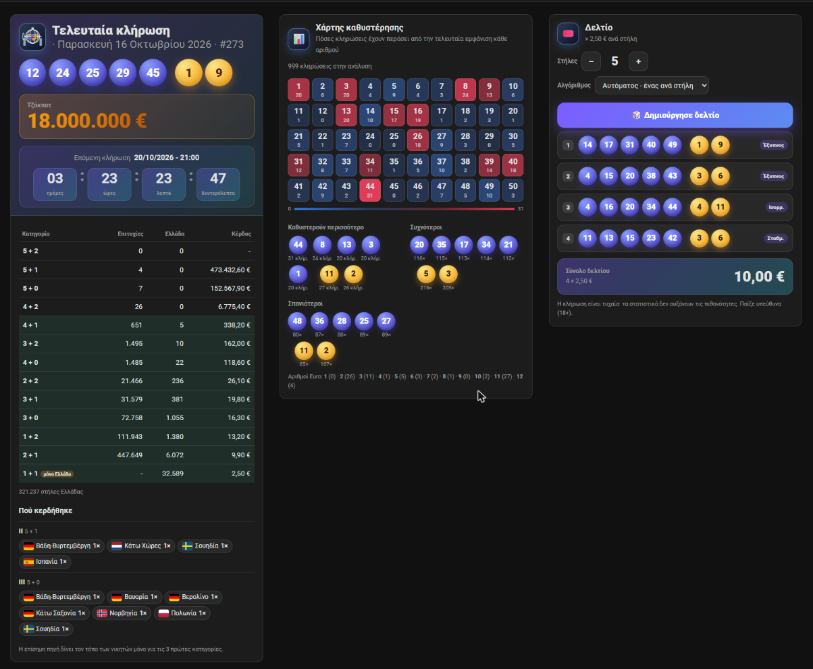

## Οντότητες
| Οντότητα | Τιμή | Attributes |
|---|---|---|
| `sensor.eurojackpot_analyzer_last_draw` | ημερομηνία τελευταίας κλήρωσης | `numbers`, `euro_numbers`, `text`, `draw_number`, `prizes` (νικητές όλων των χωρών / Ελλάδας, κέρδος ανά κατηγορία και, για τις 3 πρώτες κατηγορίες, `where_won` ανά χώρα/κρατίδιο), `total_sales`, `columns_greece`, `columns_all_countries` |
| `sensor.eurojackpot_analyzer_next_draw` | ημερομηνία και ώρα επόμενης κλήρωσης | `draw_number` |
| `sensor.eurojackpot_analyzer_jackpot` | τζάκποτ σε € | `next_draw` |
| `sensor.eurojackpot_analyzer_most_overdue_numbers` | οι 5 αριθμοί που καθυστερούν περισσότερο | `main` και `euro` με `draws_since`, `longest_gap`, `last_seen`, ο πλήρης πίνακας `all` |
| `sensor.eurojackpot_analyzer_most_frequent_numbers` | οι 5 συχνότεροι αριθμοί | `main` και `euro` με `count`, `percent` |
| `sensor.eurojackpot_analyzer_least_frequent_numbers` | οι 5 σπανιότεροι αριθμοί | όπως παραπάνω |
| `sensor.eurojackpot_analyzer_generated_ticket` | στήλες του τελευταίου δελτίου | `columns`, `total_cost`, `algorithm`, `generated_at` |
| `sensor.eurojackpot_analyzer_my_tickets` | πλήθος δελτίων (συγχρονισμένα και αποθηκευμένα εδώ) | `tickets` (κάθε δελτίο με `uid`, `target_date`, `played`, `columns`, `result`), `sync_enabled`, `synced_at` |

Τα ονόματα εμφανίζονται στα ελληνικά ή στα αγγλικά ανάλογα με τη γλώσσα του HA (τα entity IDs είναι πάντα τα αγγλικά της λίστας).

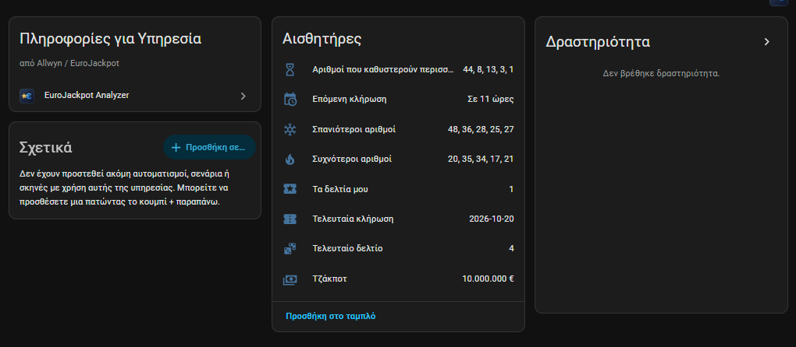

## Service `eurojackpot_analyzer.generate_ticket`
| Πεδίο | Τιμές | Προεπιλογή |
|---|---|---|
| `columns` | 1-12 | 5 |
| `algorithm` | `auto_ticket`, `auto_column`, `random`, `hot`, `cold`, `overdue`, `weighted`, `balanced`, `smart` | `auto_ticket` |
| `period` | `all`, `10y`, `5y`, `3y`, `1y`, `last_100`, `last_50` | `all` |
| `save` | `true`: προσθέτει το δελτίο στα δελτία σου για την επόμενη κλήρωση (και στο gist συγχρονισμού αν υπάρχει token) | `false` |

Η απάντηση περιέχει `columns` (κάθε στήλη με `numbers`, `euro_numbers`, `algorithm`, `text`), `total_cost` και `price_per_column`.
Το αποτέλεσμα αποθηκεύεται και στο `sensor.eurojackpot_analyzer_generated_ticket` και στέλνεται το event `eurojackpot_analyzer_ticket_generated`.

Δοκίμασέ το από **Εργαλεία προγραμματιστή → Ενέργειες**:

```yaml
action: eurojackpot_analyzer.generate_ticket
data:
  columns: 6
  algorithm: auto_column
  period: 5y
response_variable: ticket
```

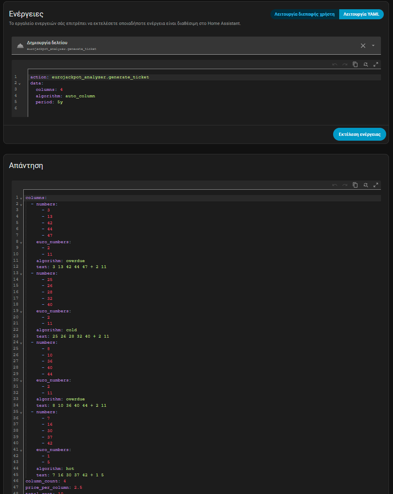

## Services `eurojackpot_analyzer.analyze_ticket` και `sync_tickets`
`analyze_ticket` επιστρέφει την ανάλυση (πιθανότητες, αναμενόμενο κόστος/κέρδος, προφίλ και έλεγχο ιστορικού) για:
- `numbers`: στήλες γραμμένες ως `5 12 23 34 45 + 3 7; 1 2 3 4 5 + 1 2` (χωρισμένες με `;`), ή
- `uid`: ένα συγχρονισμένο δελτίο (βλ. το `sensor.eurojackpot_analyzer_my_tickets`), ή
- τίποτα: το τελευταίο δελτίο που δημιουργήθηκε.

Το `country` (προεπιλογή `GR`) ορίζει τις κατηγορίες κερδών (το `GR` προσθέτει την ελληνική 1 + 1).
`sync_tickets` συγχρονίζει αμέσως με το gist (χρειάζεται token στις Επιλογές).

```yaml
action: eurojackpot_analyzer.analyze_ticket
data:
  numbers: "5 12 23 34 45 + 3 7"
response_variable: analysis
```

> Η κλήρωση είναι τυχαία. Τα στατιστικά δεν αυξάνουν τις πιθανότητες νίκης. Παίξε υπεύθυνα (18+).

## Παραδείγματα αυτοματισμών
**Ειδοποίηση όταν βγει νέα κλήρωση**

```yaml
alias: EuroJackpot - νέα κλήρωση
triggers:
  - trigger: state
    entity_id: sensor.eurojackpot_analyzer_last_draw
actions:
  - action: notify.notify
    data:
      title: EuroJackpot
      message: >
        Κλήρωση {{ states('sensor.eurojackpot_analyzer_last_draw') }}:
        {{ state_attr('sensor.eurojackpot_analyzer_last_draw', 'text') }}
```

**Δελτίο κάθε Τρίτη και Παρασκευή το πρωί**

```yaml
alias: EuroJackpot - πρόταση δελτίου
triggers:
  - trigger: time
    at: "09:00:00"
conditions:
  - condition: time
    weekday: [tue, fri]
actions:
  - action: eurojackpot_analyzer.generate_ticket
    data: { columns: 5, algorithm: auto_column }
    response_variable: t
  - action: notify.notify
    data:
      title: "Δελτίο {{ t.total_cost }} €"
      message: "{{ c.text }}\n"
```

## Επιλογές
**Ρυθμίσεις → EuroJackpot Analyzer → Ρύθμιση**: συχνότητα ανανέωσης (10-720 λεπτά, προεπιλογή 30), τιμή ανά στήλη (προεπιλογή 2,50 € για Ελλάδα· για Γερμανία βάλε 2,00 € ανά πεδίο συν την προμήθεια του παρόχου σου), υπηρεσία ειδοποιήσεων, όριο τζάκποτ και token GitHub (βλ. «Ειδοποιήσεις» και «Τα δελτία μου»).
Οι αισθητήρες ανανεώνονται επιπλέον στις 21:20, 21:50, 22:20, 22:50, 23:20 και 23:50, μετά την κλήρωση.

## Για προγραμματιστές
Ο κοινός πυρήνας (`core/rules.py`, `core/stats.py`, `core/generators.py`, `core/evaluation.py`, `core/analysis.py`, `core/ticket_sync.py`, `core/tls.py`) και το ιστορικό (`data/draws.json`) αντιγράφονται
αυτόματα από το [EuroJackpot-Analyzer](https://github.com/VeZReVouLiS/EuroJackpot-Analyzer) (`tools/sync_ha.ps1`). Μην τα
αλλάζεις εδώ.

Το front-end είναι ένα αρχείο χωρίς framework και χωρίς build (`www/eurojackpot-analyzer-card.js`). Οι σημαίες, το λογότυπο και ο κατάλογος χωρών (`www/assets/`) αντιγράφονται κι αυτά από την εφαρμογή. Για να το δεις χωρίς Home Assistant:
`python tools/make_preview_fixture.py`, `python -m http.server 8770` και άνοιξε το `http://127.0.0.1:8770/tools/preview/index.html` (παράμετροι στο hash: `#view=panel&lang=de&country=DE&theme=light&menu=country`).
Οι σημαίες είναι από το [flag-icons](https://github.com/lipis/flag-icons) (MIT).

```bash
python -m venv .venv && .venv/bin/pip install pytest-homeassistant-custom-component
.venv/bin/python -m pytest -q
```
Το Home Assistant core δεν τρέχει σε Windows· τα tests τρέχουν στο GitHub Actions (tests, hassfest και έλεγχος HACS).
